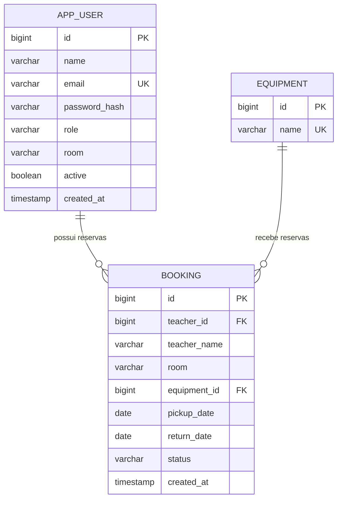

# Modelo de dados e regras do sistema

O banco tem três tabelas de negócio. As migrações Flyway criam a estrutura tanto no H2 local quanto no PostgreSQL de produção.

## Usuários — `app_user`

| Campo | Uso |
| --- | --- |
| `id` | Identificador gerado pelo banco |
| `name` | Nome da professora ou da secretaria |
| `email` | E-mail de login, único e normalizado |
| `password_hash` | Hash BCrypt da senha; nunca a senha em texto puro |
| `role` | `TEACHER` ou `SECRETARY` |
| `room` | Sala atribuída à professora; vazia antes da liberação |
| `active` | Permite desativar a conta e preservar o histórico |
| `created_at` | Data e hora de criação |

O cadastro público sempre cria uma conta `TEACHER`. O usuário não pode se promover a secretaria pelo formulário. A secretaria inicial é criada com as variáveis `SECRETARY_EMAIL`, `SECRETARY_PASSWORD` e `SECRETARY_NAME`, sem senha fixa no código.

Uma professora ativa sem sala pode entrar e consultar a agenda. A secretaria precisa atribuir uma das salas válidas para que ela possa reservar.

## Equipamentos — `equipment`

| Campo | Uso |
| --- | --- |
| `id` | Identificador do item físico |
| `name` | Nome único exibido no seletor |

A migração cadastra os sete itens solicitados: Tv 32, Tv 40, Tv 50, Retroprojetor, Notebook Cinza, Notebook Preto e Caixa de Som. Cada registro representa uma unidade; não há quantidade múltipla de um mesmo equipamento nesta versão.

## Reservas — `booking`

| Campo | Uso |
| --- | --- |
| `id` | Identificador da reserva |
| `teacher_id` | Professora responsável, vinculado a `app_user` |
| `teacher_name` | Nome da professora registrado no momento da reserva |
| `room` | Sala registrada no momento da reserva |
| `equipment_id` | Equipamento reservado, vinculado a `equipment` |
| `pickup_date` | Data de retirada |
| `return_date` | Data de devolução |
| `status` | `CONFIRMED` ou `CANCELLED` |
| `created_at` | Data e hora de criação |

O nome e a sala são copiados para a reserva. Assim, a secretaria pode alterar a sala da professora sem reescrever a sala dos agendamentos anteriores.

## Regras de negócio

- O backend identifica a professora pela sessão autenticada. O cliente não escolhe em nome de quem a reserva será criada.
- Somente uma professora ativa e com sala pode reservar.
- A retirada não pode estar no passado, e a devolução não pode ser anterior à retirada.
- As datas de retirada e devolução são inclusivas. Um item reservado de 12 a 14 fica ocupado nos três dias.
- Duas reservas confirmadas do mesmo equipamento conflitam quando `retirada_existente <= nova_devolução` e `devolução_existente >= nova_retirada`.
- A validação e a gravação são feitas em uma transação, com bloqueio do equipamento para evitar duas confirmações simultâneas do mesmo período.
- Somente a secretaria pode atribuir sala, alterar sala e remover professora.
- A remoção desativa a conta e cancela reservas confirmadas cuja devolução seja hoje ou depois. Reservas anteriores são preservadas, assim como o registro da professora.
- A data de hoje é calculada no fuso `America/Sao_Paulo`.

## Telas e API

| Tela HTML | Finalidade |
| --- | --- |
| `/index.html` | Página inicial e acessos |
| `/cadastro.html` | Criar conta de professora |
| `/login.html` | Login de professora ou secretaria |
| `/agendamentos.html` | Sala, formulário de reserva e agenda compartilhada |
| `/secretaria.html` | Atribuição de sala, alteração e remoção de professoras |

| Rota | Acesso |
| --- | --- |
| `GET /api/csrf` | Obter token para enviar ações pelo navegador |
| `POST /api/auth/register` | Cadastro público de professora |
| `POST /api/auth/login` | Login público |
| `GET /api/auth/me` | Identificar a sessão atual |
| `POST /api/auth/logout` | Encerrar a sessão |
| `GET /api/catalog` | Consultar catálogo de salas e equipamentos |
| `GET /api/bookings` | Consultar reservas como usuário autenticado |
| `POST /api/bookings` | Criar reserva como professora liberada |
| `GET /api/teachers` | Listar professoras como secretaria |
| `POST /api/teachers/{id}/assignment` | Atribuir ou alterar sala como secretaria |
| `DELETE /api/teachers/{id}` | Desativar professora como secretaria |
| `GET /actuator/health` | Verificar disponibilidade do serviço |

As ações enviadas pelo navegador usam token CSRF e cookie de sessão. Os papéis e as condições de cada operação também são verificados no backend. A tabela de reservas não apresenta o e-mail das professoras.
